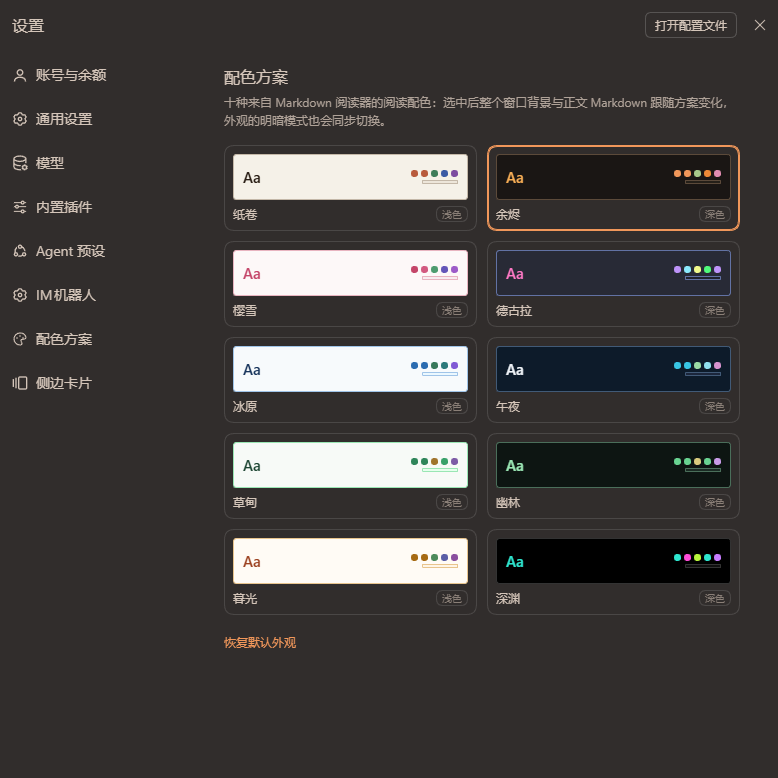

<div align="center">
  
</div>

<h1 align="center">DSH-color-style</h1>

<p align="center"><i>Colours, distilled.</i></p>

<p align="center">把 <a href="https://github.com/oipoistar/tinta">Tinta</a> Markdown 阅读器的十种阅读配色完整搬进 DeepSeek Harness —— 所有背景与对话区默认跟随，另有两个开关把墨水扩展到品牌标识与其余界面。</p>

<p align="center">
  
  
  
</p>

## 功能

配色令牌拆成两组：**表面组**（背景、边框、滚动条、各类填充）与**墨水组**（文字、图标、品牌强调色、语法高亮）。

- **所有背景色默认跟随方案** —— 表面组经 `overrideTokens` 全局生效，并在 `html/body`（`!important`）与 `#root` 做样式表级兜底：窗口画布、侧栏、输入框、菜单、弹层、气泡、代码块、diff 底色等全部跟随，不再分区域。
- **中间对话区（含文字）默认跟随方案** —— 完整令牌集重新声明在对话区根节点（`[data-conversation-content]`）上：Markdown 容器、标题、链接、行内代码、引用块、Shiki 语法高亮、气泡、思考行、会话头部面包屑与页签（对宿主硬编码颜色的行做 `!important` 钉色）。
  - Markdown 逐元素对齐 Tinta 渲染：标题用 heading、链接用 link、行内代码与代码块正文用 `code` 墨色（行内 chip 底色 = `codeBackground`）、引用块 65% 文字色 + 4px 边框、表格为 Tinta 式完整 1px 网格（18% 文字色）+ `codeBackground` 表头底色 + 6/13 对称内边距（覆盖宿主零首列内边距的样式）、h1 带 accent 下划线、行间规则用 18% 文字色；Shiki 语法色逐令牌恢复（紧凑视图强制继承的规则也会被压回）。
- **两个作用域开关（默认关闭），控制的是墨水（文字与图标）**：
  - 「品牌标识区域」—— 左上角 DeepSeek Harness 标识行（`[class*="_logoRow"]`）的墨水跟随方案的标题色（H1）：整行铺方案侧栏底色，子树与内层钩子（`_brandIdentity`/`_brandMark`/`_brandName`）钉色（鲸鱼标与字标均为 currentColor）。
  - 「其余界面区域」—— 对话区以外界面的墨水跟随方案：墨水令牌组经 `overrideTokens` 折叠为第二层，并在 `body`/`#root` 做样式表级兜底，同时钉色宿主硬编码颜色的侧栏行、搜索框、页脚与输入框内部元素。

- **会话状态背景（通用，与配色方案无关）** —— 工作区里的会话行按状态染色：
  - **正在工作**：黄色底 + 移动高光扫光（类似 Win11 进度条），数据来自 `uiSession.sessionStatus`（`running`）；
  - **完成未读**：绿色底（`completionUnread`，宿主在打开会话时自动清除）；
  - **等待选择**：橙色闪烁（`pendingInteraction` = approval / plan-review / question）；
  - **异常**：红色底——对话区出现 `turnErrorRow`（回合失败，如模型连接失败、token 耗尽）时标记该会话，打开会话即视为已读；
  - **已读无底色**；右键菜单「标记为未读」可重新变绿。行标记通过 `[data-row-key^="session:"]` + `data-dcs-state` 属性驱动，不依赖宿主内部结构。
  - 四种状态色与背景浓度可在设置页用调色盘调整（`dsh.color-style.status.colors` / `.alpha` / `.unread`）。
- **设置页独立的「配色方案」页** —— 以 `settings.section` 贡献注册，在设置导航里有自己的入口和图标；页内以卡片预览（背景 + 标题色 + 强调色点 + 代码底色）展示十种方案：双列排布，左列五个浅色、右列按色系对应的五个深色（纸卷↔余烬、樱雪↔德古拉、冰原↔午夜、草甸↔幽林、暮光↔深渊），点击即换；页面下方是两个作用域开关与「恢复默认外观」。

## 作用域开关

| 开关 | 默认 | 控制内容 | 实现 |
| --- | --- | --- | --- |
| 品牌标识区域 | 关 | 左上角标识行的**文字与图标跟随标题色（H1）** | 令牌集重声明到 `[class*="_logoRow"]` + 侧栏底色 + 子树 `color:inherit!important` 钉色 |
| 其余界面区域 | 关 | 对话区以外界面的**文字与图标** | 墨水令牌组经 `overrideTokens` 折叠为第二层 + `body`/`#root` 样式表兜底 + 侧栏/输入框钉色 |

背景不受开关影响——默认全部跟随。开关状态存 `localStorage` + cookie 镜像（`dsh.color-style.scope.brand` / `dsh.color-style.scope.chrome`），跨端口重开仍保留。
## 界面预览

设置 → 配色方案 页：十个方案以固定双列排布，左列为五个浅色方案，右列为按色系一一对应的五个深色方案。



每张卡片内是方案本身的实时预览：背景与边线取方案底色，「Aa」用方案的标题色，右侧五个圆点依次是强调色、链接色、字符串、函数与控制流的语法高亮色，底部横条为代码块底色。
当前选中的方案（截图中为「余烬」）带强调色描边；页面底部提供「恢复默认外观」一键退出方案层，回到 DSH 内置外观。

## 十种配色

| 方案 | 明暗 | 背景 | 主文字 | 强调色 |
| --- | --- | --- | --- | --- |
| 纸卷 Paper | 浅色 | `#F5F1E8` | `#3D3329` | `#B85A3C` |
| 樱雪 Sakura | 浅色 | `#FDF8F8` | `#404040` | `#C44569` |
| 冰原 Arctic | 浅色 | `#F7FAFC` | `#2D3748` | `#2B6CB0` |
| 草甸 Meadow | 浅色 | `#F7FAF7` | `#1A2F1A` | `#2F855A` |
| 暮光 Dusk | 浅色 | `#FFFBF5` | `#553C10` | `#A66A12` |
| 午夜 Midnight | 深色 | `#0D1B2A` | `#E0E1DD` | `#38C6E4` |
| 德古拉 Dracula | 深色 | `#282A36` | `#F8F8F2` | `#BD93F9` |
| 幽林 Forest | 深色 | `#0D1512` | `#B8C5B2` | `#68D391` |
| 余烬 Ember | 深色 | `#1A1614` | `#D4C5B9` | `#F1975A` |
| 深渊 Abyss | 深色 | `#000000` | `#EDEDED` | `#2EE6CF` |

色值逐字取自 [Tinta](https://github.com/oipoistar/tinta)（oipoistar/tinta）Markdown 阅读器的 `THEMES[]` 表（含 2026-08 语法色微调）。

## 透明度安全

插件**不注入任何覆盖层**：没有全屏遮罩、没有 `position: fixed` 层、不改 `pointer-events`。
背景只落在已存在的元素上（`html`/`body` 的 `background-color` 与设计令牌），不会挡住任何点击；
菜单/提示/弹层的填充保持原有的半透明合成（`alpha()` 计算），毛玻璃与悬浮层依旧可用。

## 安装

```sh
dsh plugin --profile web add dsh-color-style
```

装完刷新一次页面。下面的桌面 profile 手动链接方式适合本地开发。

## 安装（桌面 profile，本地开发）

1. 把本目录链接进 profile 的 `node_modules`（Windows 目录联接即可，无需管理员）：

   ```
   mklink /J "%DSH_PROFILE%\node_modules\dsh-color-style" "E:\DSH\插件开发\DSH-color-style"
   ```

2. 在 `profiles/desktop/package.json` 里加依赖与 bundle：

   ```json
   {
     "dependencies": { "dsh-color-style": "link:E:/DSH/插件开发/DSH-color-style" },
     "dsh": { "profile": { "bundles": [ "dsh-color-style" ] } }
   }
   ```

3. 重启 DSH。旧 tinta-themes 的选中记录会自动迁移到本插件。

## 选择持久化

选中的方案 id 存在浏览器 `localStorage`（`dsh.color-style.active`）。第三方主题 id 不进入 Host 设置 schema，
这是 dsh-client-ui-theme 文档明确的边界。选中某个方案后，该方案同时「拥有」外观的明暗模式：
如果外观被外部改走，插件会把模式拉回方案自身的明暗（上限 5 次，防止 Host 拒绝写入时打转）；
「恢复默认外观」会彻底退出方案层。
两个作用域开关同理持久化（默认关闭，控制墨水而非背景），切换时会即时重算令牌层与样式表。

## 开发

```
npm run check   # 语法检查（node --check）
npm test        # 冒烟测试（stub 掉 window/document 与 theme/slots/locale 服务）
```

测试覆盖：启动即应用已选方案、令牌层与兜底样式表内容、旧 tinta 记录迁移、外观被外部翻转后的「粘性」拉回、
重置后的完全退出、设置页十张卡片渲染与点击选方案。

## 来源与致谢

十种配色方案提取自 **[Tinta](https://github.com/oipoistar/tinta)** —— 一款 Windows 桌面 Markdown 阅读器，
本插件的全部色值（背景 / 正文 / 标题 / 链接 / 行内代码 / 代码块 / 引用边线 / 语法高亮）均来自其 `src/themes.cpp` 的 `THEMES[]` 定义，逐字保留。
感谢原作者的配色设计。

## License

MIT